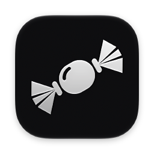
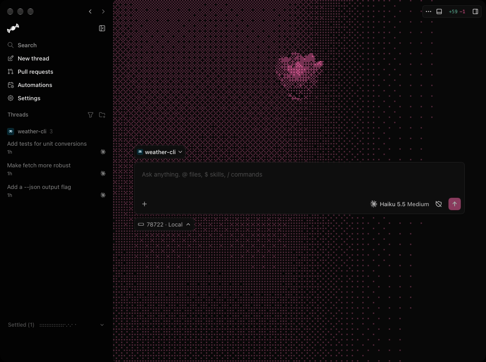
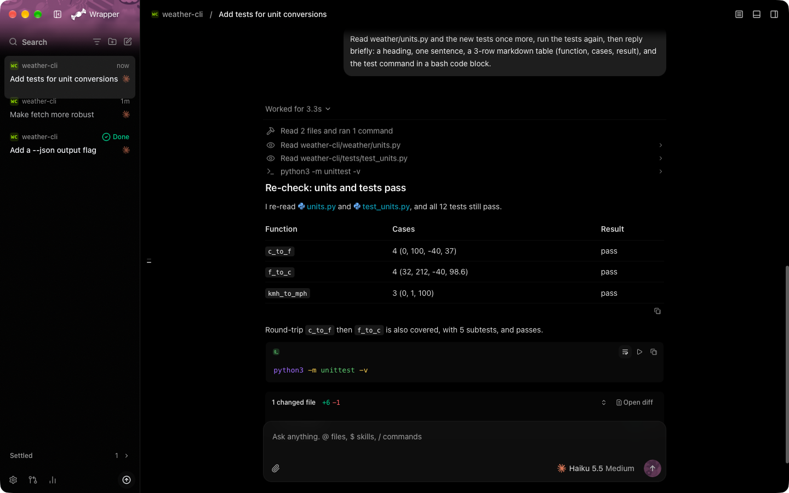
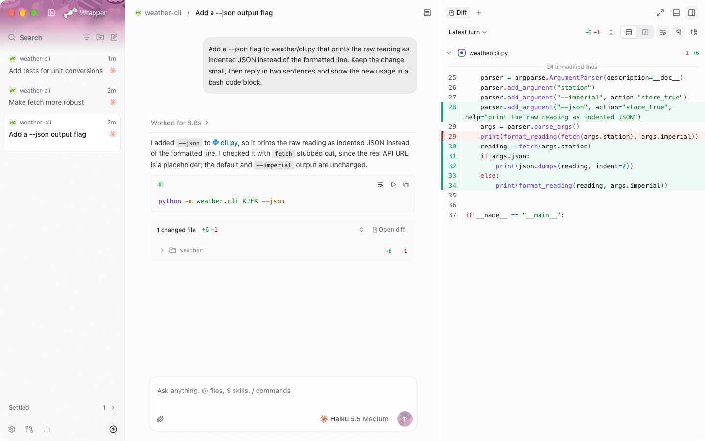
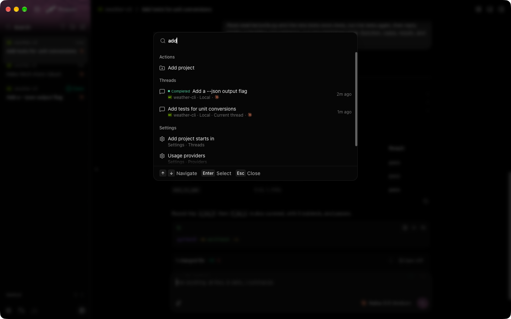

#  CandyWrapper

```text
🚨 HUMAN WRITTEN NOTE & AI-ASSISTED DEVELOPMENT NOTICE 🚨

This whole project was made with multiple opus 5.5 subagents over the span of 3 days and is still being maintained and carefully reviewed.

I made this app because I use T3 Code all day and I hated the electron and ram usage which would cause my battery to drain.
I love T3 code for the T3 Connect features so I decided to just make Candy Wrapper (Get it? Because T3 Code is a wrapper lol) anyways

CandyWrapper is a native macOS client for [T3 Code](https://github.com/pingdotgg/t3code).
Its literally just the nightly app but remade in Swift and Appkit.
I try to maintain it as long as I use T3 Code.

🚨 It's an unofficial project, not made or endorsed by T3 Tools Inc. 🚨
```



## Why I made it

I have T3 Code open all day, and the official Electron app used too much memory and drained my battery. On my Mac mini M2 Pro it woke the CPU 71.4 times a second while I was just reading a thread. So I wrote CandyWrapper, a native macOS client for T3 Code in Swift and AppKit.

| | T3 Code desktop | CandyWrapper |
|---|---|---|
| CPU while a turn streams | 18.5% | 2.10% |
| Energy Impact while a turn streams | 144.1 | 11.3 |
| Memory with a small thread open | 348 MB | 51.0 MB |
| Memory with a 2,000-message thread | 353 MB | 60.7 MB |
| CPU wakeups a second at idle | 71.4 | 0.41 |
| Launch to a ready sidebar | 1.20 s | 0.33 s |
| Slow frames scrolling 2,000 messages | 0 of 715 | 0 of 707 |
| Keypress to letter on screen | 45.0 ms | 49.9 ms |
| Download | 246 MB | 23.7 MB |

Typing is where CandyWrapper loses, by less than one frame at 60 Hz. I'd like to close that gap, but I haven't yet. I measured both apps on 2026-11-25 against T3 Code Nightly 0.1.13 (5258) with CandyWrapper 1.18.3. [docs/benchmarks.md](docs/benchmarks.md) has the method and the raw numbers.

## Install

1. Download the DMG from [Releases](https://github.com/Sowyu/CandyWrapper/releases) and drag CandyWrapper into Applications. It needs macOS 14 or later on Apple silicon.
2. Open it. macOS says it can't check the app for malware. Click Done.
3. Open System Settings, go to Privacy & Security, scroll down and click Open Anyway next to CandyWrapper. Confirm with your password.

You only do this once, because a personal developer certificate can't be notarized. After that the app updates itself.

<details>
<summary>If you have 1.14.14 or older</summary>

Install the newest DMG by hand once. The key that signed older updates is gone, so 1.14.14 and older refuse newer ones. Your settings, drafts and paired machines stay.

macOS may say 1.14.14 or older contains malware, because its certificate was revoked. It doesn't, and the newest version fixes it. On first launch, macOS asks once per saved machine about "T3 Code environment token" in your keychain. Click Always Allow.

</details>

## Connecting

CandyWrapper uses T3 Code's server if it already runs on your Mac, or starts one from your installed T3 runtime. To reach another machine, go to Settings, Connections, Add environment and paste its pairing link. Sign in to T3 Connect at the bottom of Settings to see the environments on your account.

## Screenshots

By default CandyWrapper looks like T3 Code Nightly. Redesign, in Settings, is its own experimental look with a picture or the Flower drawn in dots behind the chat.

<table>
  <tr>
    <td></td>
    <td></td>
  </tr>
  <tr>
    <td></td>
    <td></td>
  </tr>
</table>

## Building it yourself

```sh
xcodebuild -project CandyWrapper.xcodeproj -scheme CandyWrapper -configuration Release build
```

You need Xcode 27, and [XcodeGen](https://github.com/yonaskolb/XcodeGen) 2.46 if you change `project.yml`. The tests run with `cd Packages/CandyKit && swift test`.

## Thanks

CandyWrapper exists because [T3 Code](https://github.com/pingdotgg/t3code) by T3 Tools Inc. is open source under MIT. Its protocol, design and behavior all come from reading that code. CandyWrapper is MIT licensed too, see [LICENSE](LICENSE).
