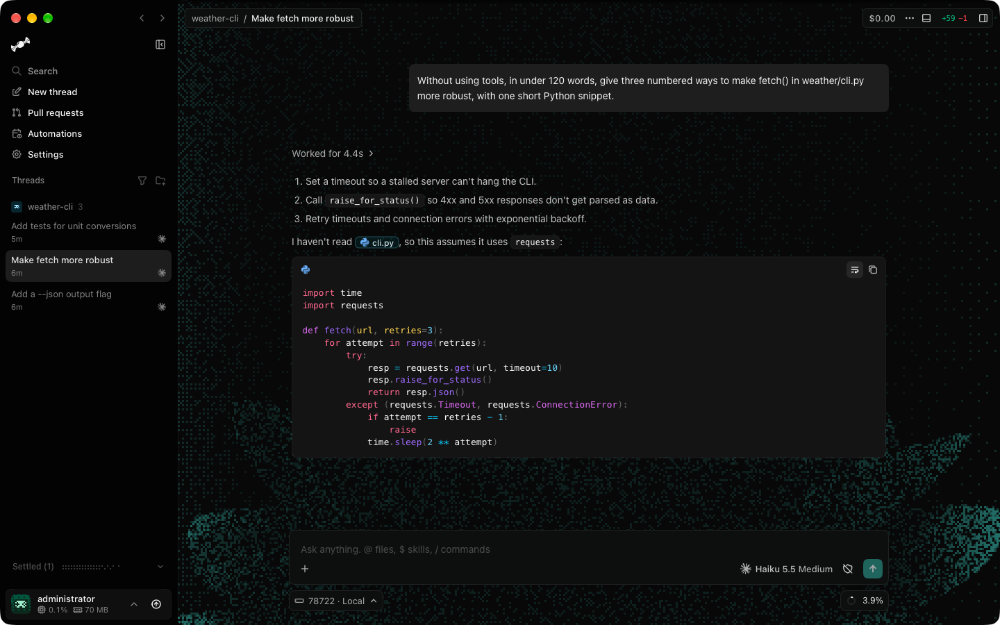
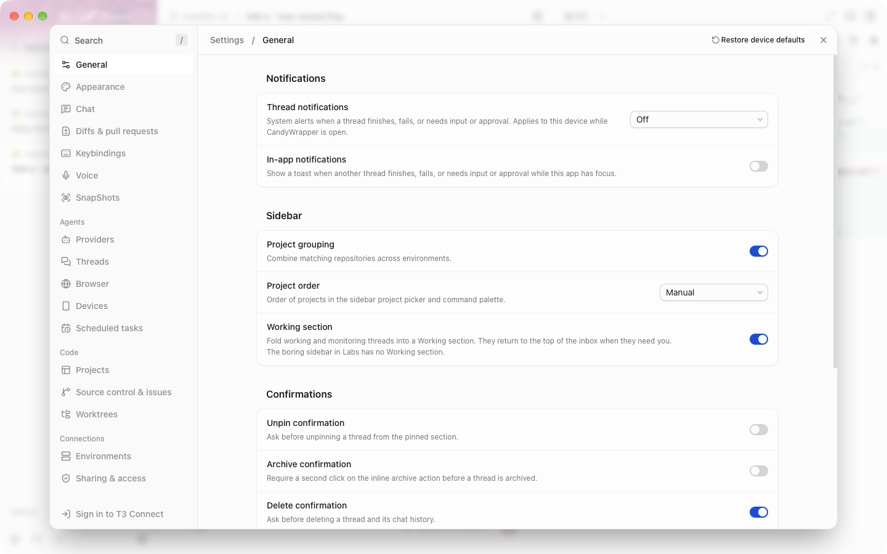

#  CandyWrapper

```text
🚨 HUMAN WRITTEN NOTE & AI-ASSISTED DEVELOPMENT NOTICE 🚨

This whole project was made with multiple opus 5.5 subagents over the span of 3 days and is still being maintained and carefully reviewed.

I made this app because I use T3 Code all day and I hated the electron and ram usage which would cause my battery to drain.
I love T3 code for the T3 Connect features so I decided to just make Candy Wrapper (Get it? Because T3 Code is a wrapper lol) anyways

CandyWrapper is a native macOS client for [T3 Code](https://github.com/pingdotgg/t3code).
Its literally just the nightly app but remade in Swift and Appkit.
I try to maintain it as long as I use T3 Code.

🚨 It's an unofficial project, not made or endorsed by T3 Tools Inc. 🚨
```


## Why I made it

I have T3 Code open all day, and the official Electron app used too much memory and drained my battery. On my Mac mini M2 Pro it woke the CPU 71.4 times a second while I was just reading a thread. So I wrote CandyWrapper, a native macOS client for T3 Code in Swift and AppKit.

These are the differences I care about most, measured on that Mac mini:

- A streaming turn uses 2.10% CPU, against 18.5% in the official app.
- Energy Impact during that turn is 11.3, against 144.1.
- A small open thread takes 51.0 MB of memory, against 348 MB.
- At idle it wakes the CPU 0.41 times a second, against 71.4.
- The download is 23.7 MB, against 246.0 MB.

Typing is where CandyWrapper loses. A keypress takes 49.9 ms to put a letter on screen, and the official app takes 45.0 ms. I think 4.9 ms is a fair price for the rest, and I'd like to close that gap, but I haven't yet.

[The numbers](#the-numbers) has the setup and the full table.

## Install

1. Download the DMG from [Releases](https://github.com/Sowyu/CandyWrapper/releases) and drag CandyWrapper into Applications. It needs macOS 14 or later on Apple silicon.
2. Open it. macOS says it can't check the app for malware. Click Done.
3. Open System Settings, go to Privacy & Security, scroll down and click Open Anyway next to CandyWrapper. Confirm with your password.

You only do this once. I sign CandyWrapper with a personal Apple developer certificate, which can't be notarized, so macOS asks the first time. After that the app updates itself from this repo.

### If you have 1.14.14 or older

Install the newest DMG by hand once. The Mac that built the releases was returned, and the update signing key went with it. Newer versions use a new key that 1.14.14 and older don't trust.

After one manual install the app updates itself again. Your settings, drafts and paired machines stay.

macOS may say that 1.14.14 or older contains malware and move it to the Trash. It doesn't contain malware. The old certificate was revoked, and installing the newest version fixes it.

The first time the new version opens, macOS asks once per saved machine whether CandyWrapper may use "T3 Code environment token" in the keychain. Click Always Allow. Deny deletes nothing, and it only leaves that machine disconnected until you allow it.

## Connecting

If T3 Code's server already runs on your Mac, CandyWrapper uses it. If not, it starts one from your installed T3 runtime and stops it again when you're idle.

To reach another machine, open Settings, go to Connections, click Add environment and paste its pairing link. Sign in to T3 Connect at the bottom of Settings to see the environments on your account.

## Redesign

Redesign is CandyWrapper's own look. It's experimental and off by default, so the app normally looks like T3 Code Nightly. Turn it on in Settings > Redesign.

It draws a picture behind the chat in dots. You can use your own picture, the desktop picture, a blurred version, or Flower. You pick the dot size, the ink colors and how much the background dims behind text.

Flower is a dotted lotus over drifting accent dots. It blooms when a thread opens, and it stops animating when the window is in the background or Reduce Motion is on.



## More screenshots




## The numbers

I ran both apps one after the other on 2026-11-25, on a Mac mini M2 Pro with 32 GB, macOS 27.2.1 and one 1080p display at 60 Hz, against copies of the same T3 server data with 50 threads. The official app was T3 Code Nightly 0.1.13-nightly.20261125.5258 and CandyWrapper was version 1.18.3, commit 3844946. I counted only each app's own processes and left out the 5258 server that both of them ran.

| What I measured | T3 Code desktop | CandyWrapper | Difference |
|---|---|---|---|
| CPU while a turn streams | 18.5% | 2.10% | 8x less |
| Energy Impact while a turn streams | 144.1 | 11.3 | 12x less |
| Memory with a small thread open | 348 MB | 51.0 MB | 85% less |
| Memory with a 2,000-message thread and 50 threads | 353 MB | 60.7 MB | 82% less |
| CPU at idle | 2.34% | 0.01% | over 99% less |
| CPU wakeups a second at idle | 71.4 | 0.41 | 174x fewer |
| Launch to a ready sidebar | 1.20 s | 0.33 s | 3x faster, see below |
| Slow frames scrolling 2,000 messages | 0 of 715 | 0 of 707 | the same |
| Keypress to letter on screen | 45.0 ms | 49.9 ms | CandyWrapper is 4.9 ms slower |
| Download | 246.0 MB | 23.7 MB | 10x smaller |
| App on disk | 563 MB | 41.9 MB | 13x smaller |

Both launch times are relaunches. The official app's time includes starting its own server, and CandyWrapper's server was already running. First launches took 3.84 s for the official app and 0.44 s for CandyWrapper.

The keypress gap is under one 60 Hz frame. I think the composer's restyle on each keystroke sometimes misses a frame, and I haven't traced it yet.

The streaming turns used Claude Haiku 5.5. Every ratio is rounded down, and [docs/benchmarks.md](docs/benchmarks.md) has the method and the raw numbers. Earlier versions of this README had numbers from a Mac mini M4, so don't compare them with these.

## Building it yourself

```sh
xcodebuild -project CandyWrapper.xcodeproj -scheme CandyWrapper -configuration Release build
```

You need Xcode 27. If you change `project.yml`, regenerate the project with [XcodeGen](https://github.com/yonaskolb/XcodeGen) 2.46 first. The tests run with `cd Packages/CandyKit && swift test`.

## Thanks

CandyWrapper exists because [T3 Code](https://github.com/pingdotgg/t3code) by T3 Tools Inc. is open source under MIT. Its protocol, design and behavior all come from reading that code. CandyWrapper is MIT licensed too, see [LICENSE](LICENSE).