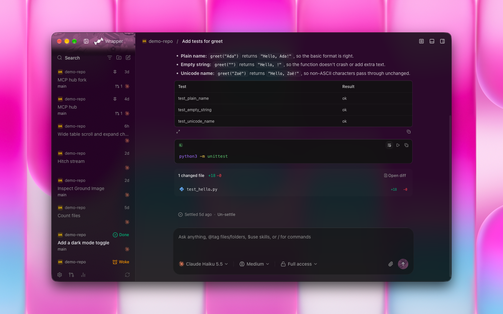
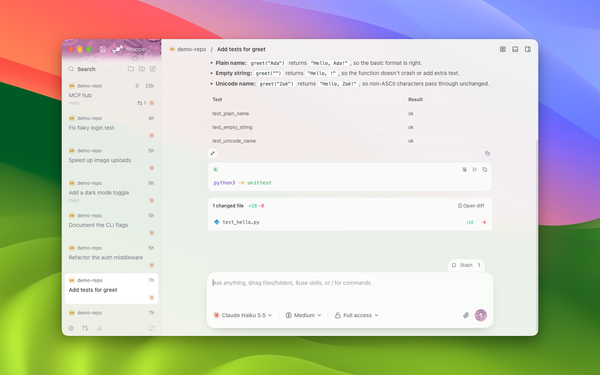

#  CandyWrapper

```text
🚨 HUMAN WRITTEN NOTE & AI-ASSISTED DEVELOPMENT NOTICE 🚨

This whole project was made with multiple opus 5.5 subagents over the span of 3 days and is still being maintained and carefully reviewed.

I made this app because I use T3 Code all day and I hated the electron and ram usage which would case my battery to drain.
I love T3 code for the T3 Connect features so I decided to just make Candy Wrapper (Get it? Because T3 Code is a wrapper lol) anyways

CandyWrapper is a native macOS client for [T3 Code](https://github.com/pingdotgg/t3code).
Its literally just the nightly app but remade in Swift and Appkit.
I try to maintain it as long as I use T3 Code.

🚨 It's an unofficial project, not made or endorsed by T3 Tools Inc. 🚨
```


## Why I made it

The official desktop app runs on Electron. On the same Mac with the same data, CandyWrapper:

- uses 16x less CPU while an agent streams a reply
- needs 89% less memory with a thread open, 39 MB instead of 381 MB
- wakes the CPU over 1,000x less often when idle
- uses 4x less energy while a reply streams
- is a 9x smaller download, 17.4 MB instead of 163 MB

I measured every one of these. The full table and how I measured are in [The numbers](#the-numbers).

## Install

1. Download the DMG from [Releases](https://github.com/Sowyu/CandyWrapper/releases) and drag CandyWrapper into Applications. It needs macOS 14 or later on Apple silicon.
2. Open it. macOS says it can't check the app for malware. Click Done.
3. Open System Settings, go to Privacy & Security, scroll down and click Open Anyway next to CandyWrapper. Confirm with your password.

You only do this once. I sign CandyWrapper with a personal Apple developer certificate, which can't be notarized, so macOS asks the first time. After that the app updates itself from this repo.

## Connecting

If T3 Code's server already runs on your Mac, CandyWrapper uses it. If not, it starts one from your installed T3 runtime and stops it again when you're idle.

To reach another machine, open Settings, then Connections, then Add environment, and paste its pairing link. Sign in to T3 Connect at the bottom of Settings to see the environments on your account.

## More screenshots


## Glass theme

Glass is a CandyWrapper-only theme that frosts the sidebar and the thread so your desktop's colors show through, and you turn it on with Change theme in the command palette.





## The numbers

I ran both apps one after the other on a Mac mini M4 on 2026-10-17, against the same T3 server data. The official app was 0.1.1-nightly.20261017.3234 and CandyWrapper was commit 1a844cb, version 1.5.0. Only each app's own processes count. Both use the same T3 server, so the server is left out.

| What I measured | T3 Code desktop | CandyWrapper | Difference |
|---|---|---|---|
| CPU while a turn streams | 15.4% | 0.92% | 16x less |
| Energy Impact while a turn streams | 46.5 | 9.7 | 4x less |
| Memory with a small thread open | 381 MB | 39.3 MB | 89% less |
| Memory with a 2,000-message thread and 50 threads | 397 MB | 46 MB | 88% less |
| CPU at idle | 2.23% | 0.00% | over 99% less |
| CPU wakeups a second at idle | 73.1 | 0.05 | over 1,000x fewer |
| Launch to a ready sidebar | 2.10 s | 0.23 s | 8x faster, see below |
| Slow frames scrolling 2,000 messages | 0 of 724 | 11 of 1,426 | CandyWrapper is worse |
| Keypress to letter on screen | 39.7 ms | 35.0 ms | 4.7 ms faster |
| Download | 163.5 MB | 17.4 MB | 9x smaller |
| App on disk | 370 MB | 30.7 MB | 12x smaller |

Both launch times are relaunches. The official app's time includes starting its own server, while CandyWrapper's server was already running. The first launch of a new CandyWrapper build took 0.71 s, and the official app's first launch on the copied data took 4.64 s while it upgraded the database. Every ratio is rounded down, and [docs/benchmarks.md](docs/benchmarks.md) has the method and the raw numbers.

## Building it yourself

```sh
xcodebuild -project CandyWrapper.xcodeproj -scheme CandyWrapper -configuration Release build
```

You need Xcode 27. If you change `project.yml`, regenerate the project with [XcodeGen](https://github.com/yonaskolb/XcodeGen) 2.46 first. The tests run with `cd Packages/CandyKit && swift test`.

## Thanks

CandyWrapper exists because [T3 Code](https://github.com/pingdotgg/t3code) by T3 Tools Inc. is open source under MIT. Its protocol, design and behavior all come from reading that code. CandyWrapper is MIT licensed too, see [LICENSE](LICENSE).
