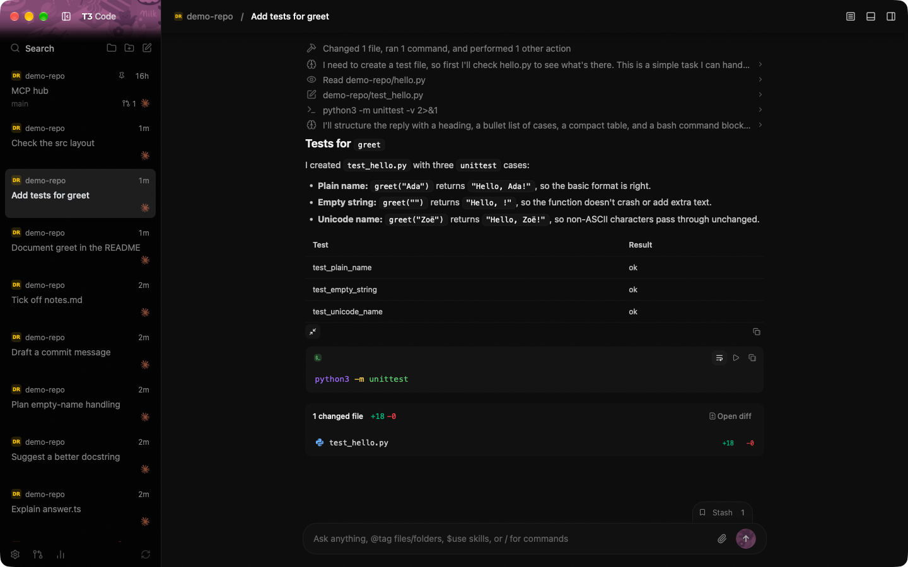
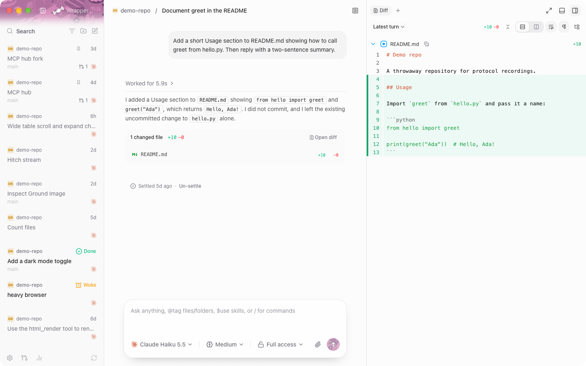
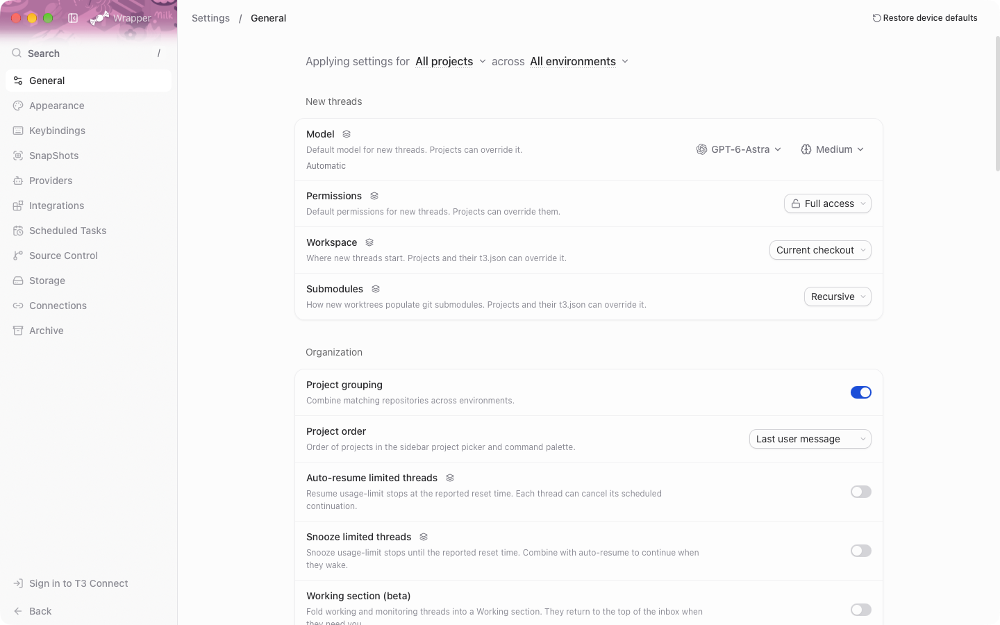

# CandyWrapper

I use T3 Code all day, and I wanted it to feel like a real Mac app. CandyWrapper is my native macOS client for [T3 Code](https://github.com/pingdotgg/t3code). It's the same app rebuilt in Swift and AppKit, so it opens in a fraction of a second and leaves the battery alone.

It talks to the official T3 server with the same protocol as the official app, so your projects, threads and agents are all there, and it looks the same as T3 Code Nightly. It's an unofficial project, not made or endorsed by T3 Tools Inc.



## Why I made it

The official desktop app runs on Electron. On the same Mac with the same data, CandyWrapper:

- uses 12x less CPU while an agent streams a reply
- needs 91% less memory with a thread open, 41 MB instead of 469 MB
- wakes the CPU over 2,000x less often when idle
- uses 5x less energy while a reply streams
- is an 11x smaller download, 14.6 MB instead of 162 MB

I measured every one of these. The full table and how I measured are in [The numbers](#the-numbers).

## Install

1. Download the DMG from [Releases](https://github.com/Sowyu/CandyWrapper/releases) and drag CandyWrapper into Applications. It needs macOS 14 or later on Apple silicon.
2. Open it. macOS says it can't check the app for malware. Click Done.
3. Open System Settings, go to Privacy & Security, scroll down and click Open Anyway next to CandyWrapper. Confirm with your password.

You only do this once. I sign CandyWrapper with a personal Apple developer certificate, which can't be notarized, so macOS asks the first time. After that the app updates itself from this repo.

## Connecting

If T3 Code's server already runs on your Mac, CandyWrapper uses it. If not, it starts one from your installed T3 runtime and stops it again when you're idle.

To reach another machine, open Settings, then Connections, then Add environment, and paste its pairing link. Sign in to T3 Connect at the bottom of Settings to see the environments on your account.

## More screenshots






## The numbers

I ran both apps one after the other on a Mac mini M4 on 2026-10-11, against the same T3 server data. The official app was 0.0.46-nightly.20261009.2861 and CandyWrapper was commit 0209d52. Only each app's own processes count. Both use the same T3 server, so the server is left out.

| What I measured | T3 Code desktop | CandyWrapper | Difference |
|---|---|---|---|
| CPU while a turn streams | 15.5% | 1.26% | 12x less |
| Energy Impact while a turn streams | 85.1 | 15.1 | 5x less |
| Memory with a small thread open | 469 MB | 41.3 MB | 91% less |
| Memory with a 2,000-message thread and 50 threads | 500 MB | 71 MB | 85% less |
| CPU at idle | 2.04% | 0.00% | over 99% less |
| CPU wakeups a second at idle | 74.5 | 0.03 | over 2,000x fewer |
| Launch to a ready sidebar | 3.71 s | 0.20 s | 18x faster, see below |
| Slow frames scrolling 2,000 messages | 1 of 912 | 0 of 1,095 | |
| Keypress to letter on screen | 37.8 ms | 37.8 ms | the same |
| Download | 162.2 MB | 14.6 MB | 11x smaller |
| App on disk | 366 MB | 27 MB | 13x smaller |

The official app's launch time includes starting its own server, while CandyWrapper's server was already running. A first launch that starts the server took 0.71 s. Every ratio is rounded down, and [docs/benchmarks.md](docs/benchmarks.md) has the method and the raw numbers.

## Building it yourself

```sh
xcodebuild -project CandyWrapper.xcodeproj -scheme CandyWrapper -configuration Release build
```

You need Xcode 27. If you change `project.yml`, regenerate the project with [XcodeGen](https://github.com/yonaskolb/XcodeGen) 2.46 first. The tests run with `cd Packages/CandyKit && swift test`.

## Thanks

CandyWrapper exists because [T3 Code](https://github.com/pingdotgg/t3code) by T3 Tools Inc. is open source under MIT. Its protocol, design and behavior all come from reading that code. CandyWrapper is MIT licensed too, see [LICENSE](LICENSE).
