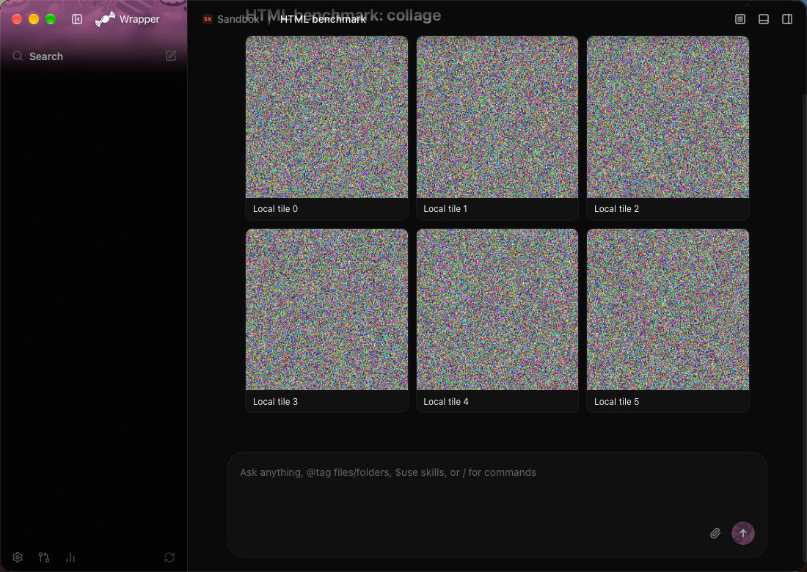
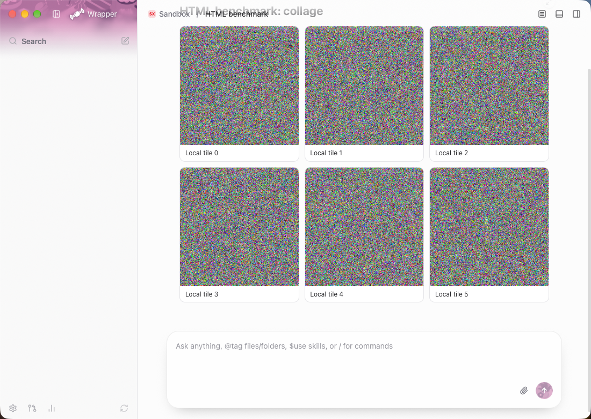
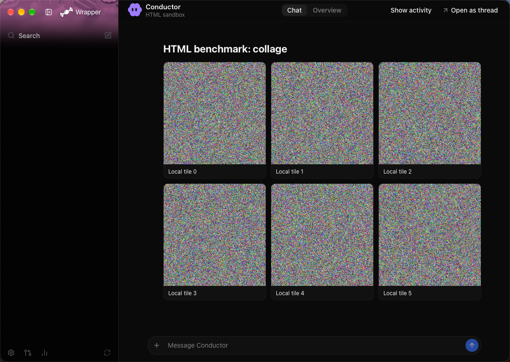
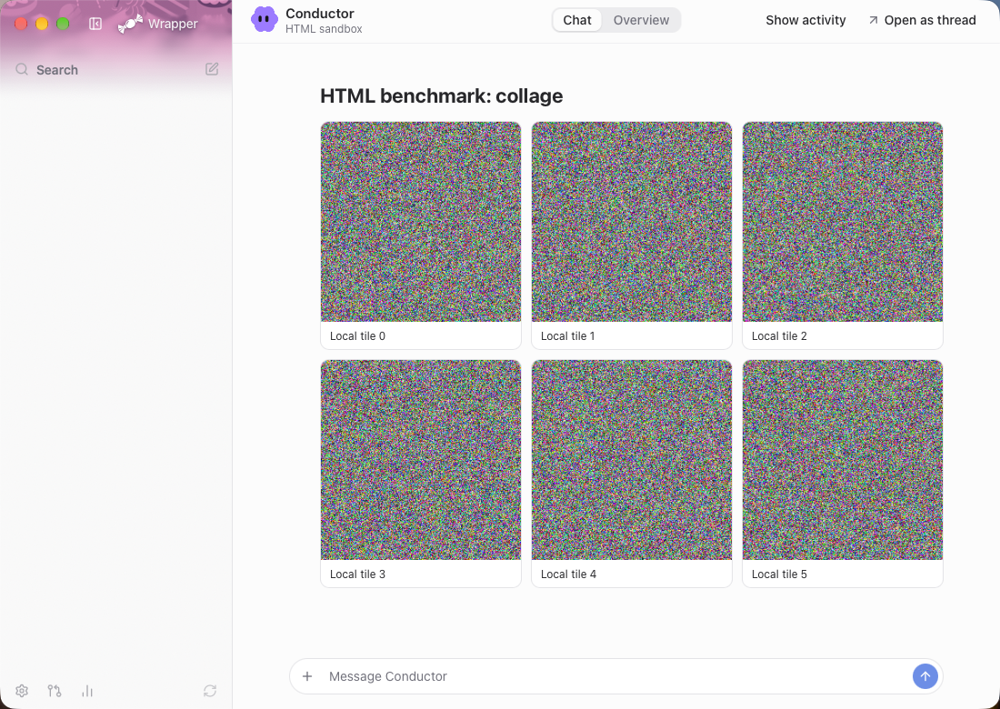

HTML pages return without blank gaps in normal threads and Conductor.
The complete sandbox matrix uses less peak memory overall and reaches every scroll position ready.

## STATUS

Implementation measured at `01df2bdc`, based on main `fb8981ce`. Final focused, full and fast tests passed. The full Release performance review recorded all 70 metrics and no regression flags. No release.

## CHANGED

- Share WebKit's ephemeral HTTP cache across the shown chat, including gaps with no live page. Hiding the chat drops its pixels and store ownership.
- Keep a 32 MiB LRU of lossless snapshot pixels in purgeable memory, keyed by attachment id, width, height, appearance and backing scale. Capture a painted page when it leaves; destroy the temporary native image view when the live page replaces it. Offscreen pages retain no browsing context after the readback finishes.
- Fetch and activate only viewport pages. Cancel departing requests, restore evicted visible frames and retain unchanged Conductor cards through state/history updates.
- Keep width-aware heights, normalize reports before deduplication and coalesce loading reports until the actual navigation finishes. Reject retired navigation/message callbacks.
- Preserve the existing sandbox, theme messages, scripts, links, image actions and shortcuts. A snapshot never intercepts input.

T3 source checked: `apps/web/src/components/chat/HtmlRenderFrame.tsx:25-108`, `apps/web/src/components/files/BrowserDocumentFrame.tsx:118-131`, `packages/shared/src/htmlRender.ts:97-132,405` and `apps/server/src/http.ts:107-128`. The server sends private one-hour HTTP caching; its bootstrap reports height from DOMContentLoaded, ResizeObserver and load. WKProcessPool is deprecated and supplies no useful process-sharing control here. The app-wide three-frame limit remains unchanged.

PNG preview encoding, unbounded WebKit host reuse, a custom image drawing view and captures on load were rejected after memory measurements. The final implementation uses fresh document views and captures only departing pages. The raw rejected runs remain local.

## VERIFIED

### Same-workload sandbox comparison

Before: original renderer `6e3adef` with benchmark `ba2fdef` and diagnostic-only `02104618`, which removes four extra snapshot callback lines. After: `01df2bdc`. Both use the actual ThreadPanelView and OrchestratorPaneView, a stable 1100 × 780 window, Redesign, fake T3 Connect and the same thirty attachment ids/content hashes. Only expired signed URL fields were refreshed. No live T3 writes or model turns.

Each workload repeats across ten references: light report (6,816 HTML bytes), collage (1,038,948 local PNG bytes in 1,392,065 HTML bytes), and script chart (6,555 HTML bytes, 1,200 samples). Both corrected batches completed 80/80 arrivals and recorded zero competing-build samples. The after batch completed 160/160 scroll visits with zero blanks; before completed 73/160, with 87/160 blank viewport checks. Neither batch uses diagnostic resident WebKit readbacks.

Pooled first-ready median across eighty arrivals: **148.585 → 141.580 ms**. Conductor arrival medians improve by 20–27%. Normal-thread cold arrivals are nearly flat; the light case increases by 1.680 ms. Completed normal back passes improve by 57–62%. Before has no complete normal return or Conductor pass, so those times remain unavailable.

All times below are milliseconds. Each scroll value sums first-ready waits across ten paced visits, with completion counts in parentheses. The unchanged two-second wait at each position is not a speed result.

| Workload / mode / theme | Arrival median, before → after | Back ready wait, before → after | Return ready wait, before → after | Blank viewports / 20, before → after |
|---|---:|---:|---:|---:|
| light / thread / dark | 144.082 → 145.762 | 1010.690 (10/10) → 385.186 (10/10) | unavailable (8/10) → 403.006 (10/10) | 2 → 0 |
| light / conductor / dark | 188.142 → 137.950 | unavailable (0/10) → 352.748 (10/10) | unavailable (0/10) → 330.934 (10/10) | 20 → 0 |
| collage / thread / dark | 144.312 → 136.728 | 954.436 (10/10) → 414.882 (10/10) | unavailable (9/10) → 377.311 (10/10) | 1 → 0 |
| collage / conductor / dark | 198.142 → 147.820 | unavailable (0/10) → 377.998 (10/10) | unavailable (0/10) → 352.907 (10/10) | 20 → 0 |
| chart / thread / dark | 139.712 → 139.444 | unavailable (9/10) → 400.549 (10/10) | unavailable (8/10) → 361.191 (10/10) | 3 → 0 |
| chart / conductor / dark | 187.453 → 140.111 | unavailable (0/10) → 340.050 (10/10) | unavailable (0/10) → 355.434 (10/10) | 20 → 0 |
| collage / thread / light | 143.557 → 137.660 | 963.408 (10/10) → 412.452 (10/10) | unavailable (9/10) → 396.218 (10/10) | 1 → 0 |
| collage / conductor / light | 184.637 → 147.770 | unavailable (0/10) → 259.091 (10/10) | unavailable (0/10) → 317.036 (10/10) | 20 → 0 |

Worst simultaneous sampled combined peak: **222.172 → 203.527 MB**, down 8.4%. The dark normal collage increases **0.425 MB**; every other case decreases. App launch peaks remain about 84–87 MB. WebKit stays at five sampled processes: one GPU, one networking and three content processes. These changes reduce memory overall; they do not reduce process count.

Memory uses decimal MB. Combined peaks are simultaneous sums, not sums of separate process peaks.

| Workload / mode / theme | App sampled peak MB, before → after | App + WebKit peak MB, before → after | WebKit sampled peak, before → after |
|---|---:|---:|---:|
| light / thread / dark | 87.131 → 87.295 | 173.036 → 170.579 | 5 → 5 |
| light / conductor / dark | 83.772 → 72.926 | 180.688 → 166.761 | 5 → 5 |
| collage / thread / dark | 47.073 → 87.311 | 198.727 → 199.152 | 5 → 5 |
| collage / conductor / dark | 83.346 → 83.658 | 219.616 → 193.123 | 5 → 5 |
| chart / thread / dark | 47.007 → 87.180 | 184.390 → 178.607 | 5 → 5 |
| chart / conductor / dark | 78.710 → 83.658 | 183.768 → 173.003 | 5 → 5 |
| collage / thread / light | 47.285 → 87.229 | 205.640 → 203.527 | 5 → 5 |
| collage / conductor / light | 44.009 → 83.936 | 222.172 → 191.304 | 5 → 5 |

[Public per-case and per-visit values](html-render-2026-10-25/comparison.json). Private raw roots: `~/CandyWrapper-research/sandbox/html-benchmark/baseline-no-readback/` and `after-departure/`, each with the manifest used, metadata, derived results, events, memory samples and app logs. The after metadata hashes both the Debug launcher and `CandyWrapper.debug.dylib`. The expired baseline attempt remains explicitly invalid in its own directory. The earlier noisy/readback batches are not used for ratios.

### Repeating the benchmark

Start the sandbox with `scripts/sandbox-server`. For a new experiment only, run `python3 scripts/html-benchmark/prepare.py` once to generate its deterministic attachments. Never regenerate between its before and after batches. After a passing preflight, build with `CANDY_BUILD_JOBS=2 scripts/build-test-app html-benchmark` and sign with `swift scripts/html-benchmark/sign.swift`. Signing only requests sandbox asset URLs, with no turns or orchestration writes.

Before a quiet capture, verify all signed URLs still return HTTP 200 and their prepared content hashes. Preserve a private `manifest-used.json` under each new tag; copy it before launching. Take `scripts/ui/screen-lock take html-benchmark`, then run `python3 scripts/html-benchmark/run.py --tag <new-tag>` in the background. The eight cases take about nine minutes. `capture-one.py --tag <new-visual-tag> --label after` captures all four first pages. Quit only owned apps and give the screen back within fifteen minutes. The runner refuses to overwrite existing event files.

Run `summarize.py <raw-root>` and `scroll-summary.py <raw-root>`, then `compare.py <before-root> <after-root>`. The comparison rejects non-URL fixture changes and keeps incomplete pass times unavailable. Hash both the executable and Debug dylib, record the source commit/diff, and inspect the competing-build samples. Delete only the task's DerivedData after capture. Signed URLs, private manifests and process logs stay in the sandbox.

### Visual checks

Authoritative before/after captures show page one before page two arrives. All six local tiles render in both themes and modes. The four page regions each differ by only one channel level in one pixel (370,125 pixels for normal threads, 392,675 for Conductor). [Pixel comparison](html-render-2026-10-25/visual-comparison.json).

| Mode / theme | Before | After |
|---|---|---|
| thread / dark |  |  |
| thread / light |  |  |
| conductor / dark |  |  |
| conductor / light |  |  |

Separate diagnostic captures pause only the owned app after a cached first-page layout, before live-page readiness, then capture the live page at the same scroll position. All four cached pages were visibly populated. These captures are excluded from timings and remain under `after-cached-visual/`. WebKit snapshot readback resamples the high-frequency noise tiles differently from the live GPU surface; temporary cache pixels are not a pixel-identical GPU readback. The final live page matches the before capture.

### Tests and review

Final Debug checks passed on `01df2bdc`: 32 focused checks, 2,088 Swift Testing tests plus 18 XCTest tests in the full suite, and 1,897 plus 18 in the fast lane. Cache tests cover byte cost/LRU, exact raw-pixel round trips, pressure/pinning, key separation and invalidation generations. Lifecycle tests cover shared-store ownership, Force Reload, retired callbacks, viewport release/reload, unchanged Conductor cards and width-aware/deduplicated heights.

The final code review checked cache and provider ownership, stale asynchronous work, sandbox/message/navigation guards, theme/scale keys, viewport cancellation and the main branch's paging changes. It found no additional blocker. [Exact source and binary hashes](html-render-2026-10-25/provenance.json).

The [full Release review](2026-10-26-01df2bd-w1.md), [raw metrics](2026-10-26-01df2bd-w1.json), ran all three repetitions against `2026-10-25-14567ec-w1.json`: 70 metrics, no regression flags. It used a verified isolated Release bundle of `01df2bdc`, the frozen sandbox workload and no billed turn. The app scenarios passed the quiet guard. The stock package runner performed an additional test-product compilation after its first quiet gate before executing the microbenchmarks; this limits how strictly those timings can be called quiet. The review's worktree, package products, copied app and DerivedData were removed afterward. Final preflight passed at 40 GB free.

## OPEN

This is one quiet batch, not a statistical distribution. Each case starts a fresh app; its ten sequential arrivals share caches. First display of an attachment is not ten independent cold app launches. Arrival starts at UI projection delivery with prepared signed URLs, excluding socket delivery and signing. Page completion follows image/font decode, two animation frames and native layout; it is a paint opportunity, not a display fence. Cached readiness follows native image layout. Real scrolling can be faster than the fixed two-second benchmark pace.

Process ownership is inferred from newly spawned WebKit PIDs with the same inherited responsibility ancestor, excluding pre-launch helpers. Sampling once a second can miss short process/memory spikes; app lifetime peaks are retained separately in raw data. Cache entries can be purged or evicted, and a page then follows the normal loading path. The 32 MiB cap retains fewer large pages on a Retina display than on this 1× virtual screen. Temporary snapshots preserve layout and content but can resample images; final pages are unchanged.

The light normal-thread cold median (+1.680 ms), dark normal collage memory (+0.425 MB) and unchanged process count remain visible above. No per-case or process-count improvement is claimed for them.

Nightly failed at its provider weekly limit; the T3 pin remains 3473.
